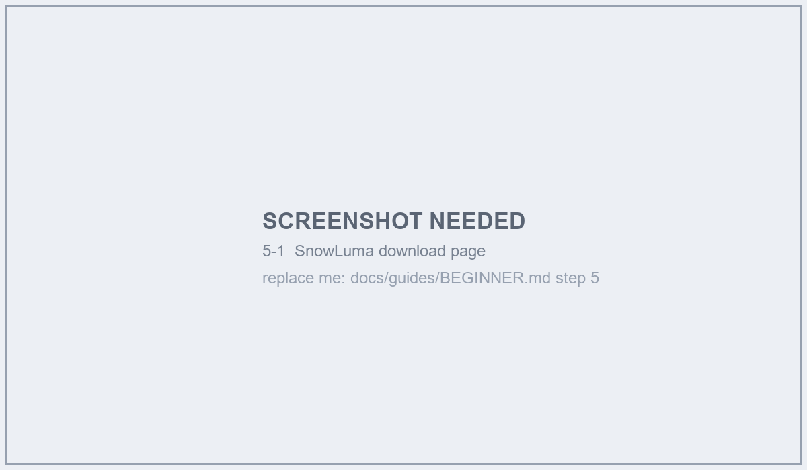
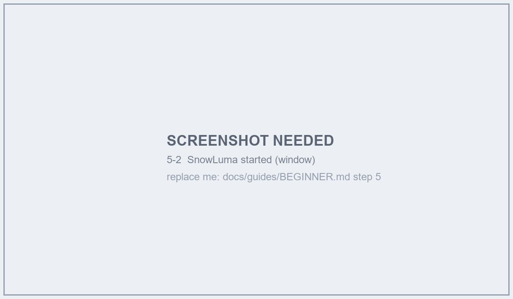
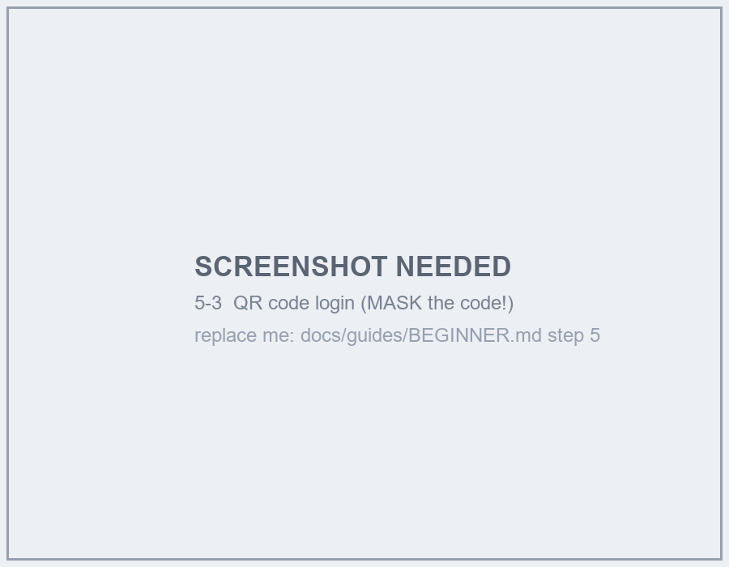
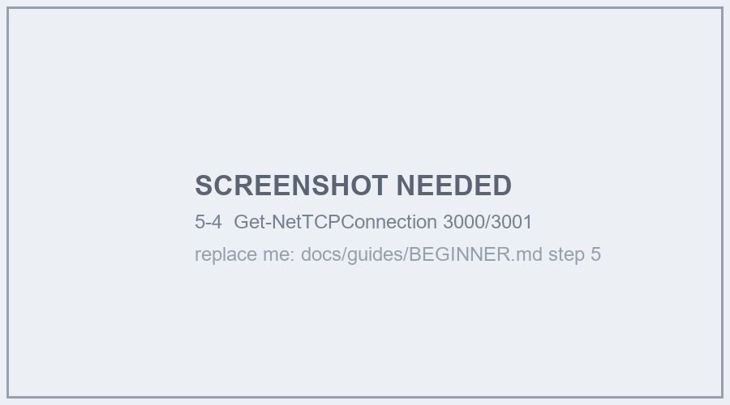
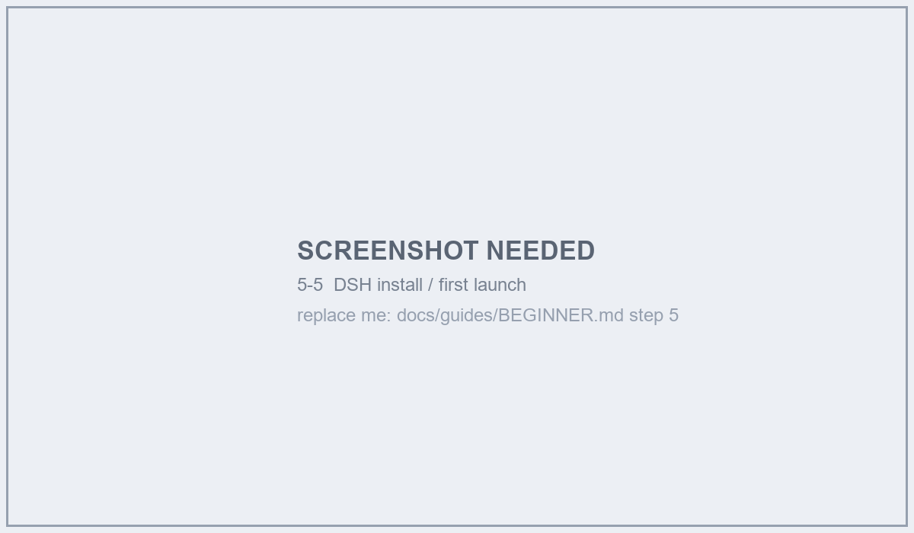
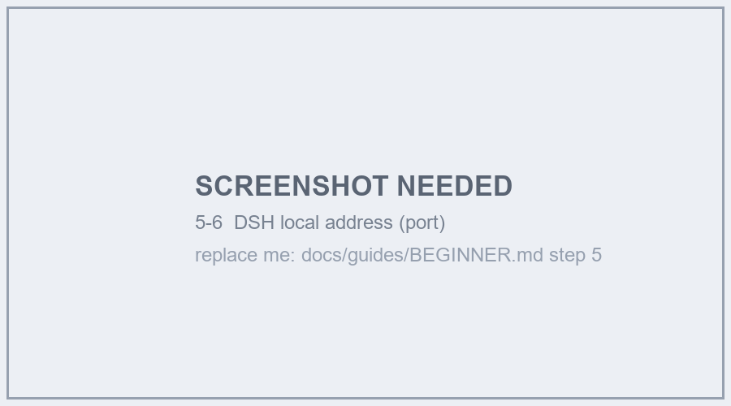

# 零基础八步：从一台空电脑到「大肥鱼在群里回话」

> 这份是给**没写过代码**的人看的。每一步都写清三件事：
> **做什么 → 你应该看到什么 → 没看到怎么办**。
>
> 已经会命令行的人可以看更快的 [QUICKSTART.md](../../QUICKSTART.md)；
> 踩坑细节在 [FRESH-INSTALL.md](FRESH-INSTALL.md)。

---

## 开始前：先认清三个角色

| 名字 | 是什么 | 你需要做什么 |
| --- | --- | --- |
| **qq-bridge**（本项目） | 翻译官：把 QQ 消息转给 AI，再把 AI 的话发回 QQ | 装它、启动它 |
| **SnowLuma** | 登录你自己的 QQ 号（扫码），负责收发消息 | 装它、扫码登录 |
| **DSH** | 跑 AI 的地方（模型、人格、工具都在这里） | 装它、启动它 |

> 三个都要在跑，缺一个都不行。**本项目不会替你启动后两个**（它们要登录、要账号）。

**准备清单**

- [ ] 一台 Windows 10/11 电脑（Linux 也能跑，见 QUICKSTART）
- [ ] 一个**你自己**的 QQ 号（建议用小号，别用主号）
- [ ] 这个 QQ 号已经在你要测试的群里

---

## 第 1 步：装 Node.js（AI 项目的"运行环境"）

1. 打开 <https://nodejs.org> → 下载 **LTS** 版本 → 一路下一步
2. 装完**关掉所有命令行窗口**，重新开一个 PowerShell
3. 输入：

```powershell
node -v
npm -v
```

**你应该看到**：两个版本号，`node` 那个 **≥ v22.13**（低了不行，缺内置 WebSocket）。

**没看到怎么办**

| 现象 | 原因 | 解决 |
| --- | --- | --- |
| `node: 无法识别` | PATH 没生效 | 关掉窗口重开；还不行就重装 Node 并勾选 "Add to PATH" |
| 有 `node` 但没有 `npm` | 装的是精简版 | 重装官方 Node（自带 npm） |
| 版本 < 22.13 | 装成了旧版 | 卸载重装 LTS |

---

## 第 2 步：把代码拿下来

```powershell
cd D:\
git clone https://github.com/juju114514/qq-bridge.git
cd qq-bridge
```

没有 `git`？去 <https://git-scm.com/download/win> 装一个，或者直接下载 ZIP 解压。

**你应该看到**：`D:\qq-bridge` 里有 `package.json`、`src`、`scripts` 这些。

---

## 第 3 步：一条命令跑安装

```powershell
.\scripts\first-run.ps1
```

它会做四件事：体检 → 装依赖 → 生成 `config.json` → 问你要不要现在启动。

> 如果提示 **"禁止运行脚本"**，先执行下面这行，再重跑上面那条：
>
> ```powershell
> Set-ExecutionPolicy -Scope Process -ExecutionPolicy Bypass
> ```

**你应该看到**：一屏 OK/警告，最后生成 `config.json`。

---

## 第 3.5 步：不确定环境对不对？双击 `自检.bat`

仓库根目录有 **`自检.bat`** —— 双击它，会逐项检查
Node 版本 / 依赖 / 配置 / state 可写 / 端口 / DSH / SnowLuma / 人格卡，
每条都写「OK / 警告 / 致命」以及该看哪份文档。

```
[OK]  Node 版本
[OK]  依赖已安装
[!!]  DSH 连不上 —— 先启动 DSH 桌面版（见 阶段 4）
```

> 退出码 0=通过、2=警告、1=致命。**修完再双击一次**，直到全是 OK。

## 第 4 步：填三个地方（**最容易卡死的地方**）

用记事本打开 `config.json`：

```jsonc
{
  "ownerQQ": 你的QQ号,              // ← 改成你自己的号（管理员）
  "allow": {
    "groups": [ 123456789 ],        // ← 要让它回话的群号
    "private": []                   // 私聊白名单，建议先留空
  },
  "dsh": { "provider": "deepseek-official", "model": "deepseek-flash" }
}
```

> ⚠️ **空白名单 = 谁都不回。** 这是新手最常见的"它怎么不理我"。
> 群号在 QQ 群设置 → 群号那一串数字。

---

## 第 5 步：装并登录两个外部程序（附截图位）

> 这一步是**唯一脚本代劳不了**的：两个程序都要**下载安装 + 扫码/图形登录**。
> 下面把每个小步骤拆开，并留了截图位 —— 补图的人按标注的文件名放进
> `assets/beginner/`，再把注释里的 `` 那行取消注释即可。

### 5.1 SnowLuma（登录你的 QQ 号）

**① 下载并解压**


<!-- 截图位（占位图已入库；换成真实截图时覆盖同名文件即可） -->

- 下载后**解压到一个没有中文和空格的路径**（例如 `D:\QQBot\snowluma`）
- ⚠️ 路径里有中文/空格，是后面"连不上 3001"最常见的原因

**你应该看到**：解压出来的目录里有 `node.exe` 和 `index.mjs` 这类文件。

---

**② 启动它**


<!-- 截图位（占位图已入库；换成真实截图时覆盖同名文件即可） -->

- 双击启动脚本（或在解压目录里运行 `node index.mjs`）
- 第一次会开一个**登录界面**

**你应该看到**：窗口里提示扫码，或者出现二维码。

---

**③ 用手机 QQ 扫码**


<!-- 截图位（占位图已入库；换成真实截图时覆盖同名文件即可） -->

- 手机 QQ → 右上角「+」→ **扫一扫**
- **建议用小号**（主号有风控风险）

**你应该看到**：电脑上提示"登录成功 / 已在线"。

---

**④ 确认两个端口开着**


<!-- 截图位（占位图已入库；换成真实截图时覆盖同名文件即可） -->

```powershell
Get-NetTCPConnection -State Listen | Where-Object { $_.LocalPort -in 3000,3001 } |
  Select-Object LocalPort, OwningProcess
```

**你应该看到**：`3000` 和 `3001` 各一行。

**没看到怎么办**

| 现象 | 原因 | 解决 |
| --- | --- | --- |
| 只有 3000 没有 3001 | 只开了 HTTP，没开 WebSocket | 去 SnowLuma 配置里把 WS 服务打开 |
| 两个都没有 | 没启动 / 启动失败 | 看它的窗口报错；路径带中文也会导致失败 |
| 登录二维码一直不刷新 | 网络/风控 | 重启 SnowLuma 再扫；别连续扫十几次 |

---

### 5.2 DSH（跑 AI 的地方）

**① 安装并启动**


<!-- 截图位（占位图已入库；换成真实截图时覆盖同名文件即可） -->

- 装完双击桌面图标启动
- 第一次会要你**登录**（用 DeepSeek 账号）

**你应该看到**：一个聊天界面，能正常对话。

---

**② 找到它的"本机地址"**


<!-- 截图位（占位图已入库；换成真实截图时覆盖同名文件即可） -->

- 一般在「设置 → 关于/开发者」里，形如 `http://127.0.0.1:57495`
- **端口每次启动都可能不同，这是正常的**（桥接会自动发现）

**你应该看到**：能把这个地址粘到浏览器里打开、不报错。

**没看到怎么办**

| 现象 | 原因 | 解决 |
| --- | --- | --- |
| 浏览器打不开那个地址 | 记错端口 / DSH 没起来 | 看 DSH 窗口是否还在；重新看地址 |
| 桥接日志报 `401` | DSH 重启后端口变了 | 重启桥接（双击 `restart.bat`），它会重新发现 |
| DSH 里对话正常但桥接不回复 | 模型/预设没装 | 跑 `node scripts/setup-dsh.mjs` 装 `qq-chat-v2` 预设与 MCP |

---

### 截图清单（补图的人看这里）

| 文件名 | 拍什么 | 建议宽度 |
| --- | --- | --- |
| `5-1-download.png` | SnowLuma 下载页 | ≥ 900px |
| `5-2-start.png` | 启动后的窗口 | ≥ 900px |
| `5-3-qrcode.png` | 扫码界面（**别把二维码原图留下**，打码或重截） | ≥ 700px |
| `5-4-ports.png` | 上面那条端口命令的输出 | ≥ 700px |
| `5-5-dsh-install.png` | DSH 安装/首启界面 | ≥ 900px |
| `5-6-dsh-port.png` | DSH 里显示的本机地址 | ≥ 700px |

> 放到 `assets/beginner/`（该目录已在 `.gitignore` 里放行，可以正常提交）。
> **现在是灰底占位图**：拍好真实截图后**覆盖同名文件**即可，文档不用改。

---
## 第 6 步：启动桥接（双击就行）

在仓库根目录**双击 `start.bat`** —— 它会在一个窗口里启动桥接，
挂了会自动 5 秒后重启（这就是"守护"）。

> 想用命令行也行：`.\start-bridge.ps1`
> 改了配置要重启：**双击 `restart.bat`**（它会先按锁文件 PID 杀掉旧实例，避免双开）

**你应该看到这三行**（顺序可能不同）：

```
[bridge] SnowLuma 已连接：ws://127.0.0.1:3001
[bridge] DSH 已就绪（模式: reserved2）
[bridge] 本地控制台已启动：http://127.0.0.1:3100
```

看到这三行 = 三条腿都通了。**缺哪行就修哪条腿**：

| 缺哪行 | 说明 | 先查 |
| --- | --- | --- |
| SnowLuma 没连上 | 网关没开或没登录 | 浏览器开 `http://127.0.0.1:3000` 有没有反应 |
| DSH 没就绪 | DSH 没启动 / 端口变了 | 看 DSH 窗口，或 `.\start-bridge.ps1 -Status` |
| 控制台没起来 | 3100 被占 / 端口配错 | 换 `consolePort`，或用 `-Status` 看谁占着 |

---

## 第 7 步：验证它真的活了

1. **浏览器打开** <http://127.0.0.1:3100> → 应该看到控制台页面
2. **群里 @ 它一次**，比如 `@小鲸鱼 在吗`
3. **看日志**：

```powershell
Get-Content .\state\bridge.log -Tail 20
```

**你应该看到**：日志里有 `[消息]` / `唤醒` / 发送成功的行，群里也真的回了。

**没回？按这个顺序查**（90% 的"不理我"是前两条）：

| 检查 | 怎么看 |
| --- | --- |
| ① 白名单里有这个群吗 | `config.json` 的 `allow.groups` |
| ② AI 是不是被暂停了 | 控制台「二代 AI」开关；或 `GET /api/status` 看 `socialV2Paused` |
| ③ 模式对吗 | `chat` 模式是纯聊天；仿真模式才是 `reserved2` |
| ④ 是不是没被唤醒 | 默认只在 **@ / 叫名字 / 关键词** 时醒，不是每条都回 |

---

## 第 8 步：让她记住你（这一步才是"完整的一生"）

到这里她只会"接话"，还不会"记得你"。三件事：

### 8.1 人格卡：决定她是谁

`roles/` 目录下每个 `.md` 就是一张人格卡。默认那张是「小鲸鱼」。

> 改人格卡请**另存一份**再改（`roles/我的角色.md`），别改默认的，
> 这样以后升级不会丢。改完在控制台「人格」页切换。

### 8.2 记忆：决定她记得什么

- **人物库**：控制台 →「人物库」，能看到她对每个人的印象（昵称、偏好、忌讳）
- **长期记忆**：她会自己写；你也可以在控制台看/删
- **让她记住你的方式**：多聊、纠正她（"别这么叫我"），她会写进记忆

### 8.3 群黑话：决定她像不像这个群的人

控制台 →「黑话」：它会自己从群聊里学，学到的会注入提示词。

---

## 常见卡点速查表

| 症状 | 最可能的原因 | 一条命令/一个动作 |
| --- | --- | --- |
| 群里 @ 不回 | 空白名单 / AI 暂停 | 查 `allow.groups`；看 `/api/status` 的 `paused` |
| 控制台打不开 | 3100 被占 / `consolePort` 写错 | `.\start-bridge.ps1 -Status`；端口必须是 1~65535 整数 |
| 日志里 `401` | DSH 端口变了 | 桥接会自动发现；不行就重启一次 |
| `SnowLuma 连接失败` | 网关没开 / 没扫码 | 先开 SnowLuma 并登录 |
| QQ 里刷 `agent 处理出错` | 换过模型，报错被推到 QQ | `socialV2.notifyAgentErrors: false` |
| `它说话像客服` | 人格卡被改坏了 | 换回默认卡；或看控制台「提示词」对比 |
| 启动报 `config 格式错误` | JSON 写坏了（多逗号/中文引号） | 用 VS Code 打开，或删掉重跑 `first-run.ps1` |

---

## 术语小抄（听不懂时回来看）

| 词 | 意思 |
| --- | --- |
| `bridge` | 本项目本体，那个"翻译官" |
| `DSH` | 跑模型的宿主程序 |
| `SnowLuma` | 登录 QQ、收发消息的网关 |
| `preset` | DSH 里的"技能包"，决定 AI 有哪些工具 |
| `agentToken` | 每个会话的一次性令牌，AI 调工具时要带上 |
| `reserved2` | 仿真模式：AI 自己决定何时说话、说什么 |
| `consolePort` | 控制台网页的端口（默认 3100） |

---

## 下一步

- 想更快：看 [QUICKSTART.md](../../QUICKSTART.md)（一页版）
- 卡在某个具体报错：看 [FRESH-INSTALL.md](FRESH-INSTALL.md)（按阶段列了坑）
- 想知道她有哪些能力：看 [../../COMMANDS.md](../../COMMANDS.md)
