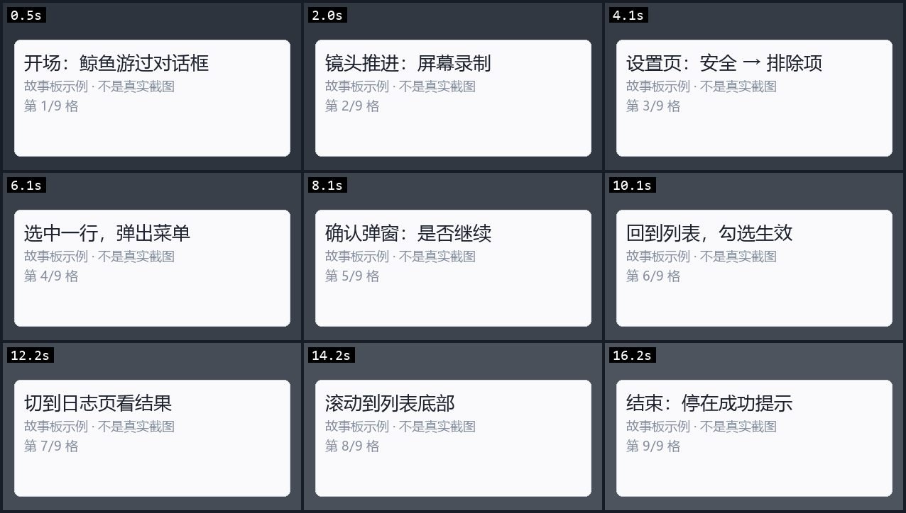

# 视频理解：把视频拆成「一张故事板 + 一段转写」

> 模型**看不了视频**。DSH 的图片入口只吃静态图，所以「识别视频」在工程上的唯一解法是
> **降维**：均匀抽几帧拼成一张图（故事板），再把音轨转成文字。别指望"把视频传给模型"。



<sub>上面是**合成的**示例图（`scripts/make-video-storyboard-sample.py` 生成），用来说明版式：
3×3、每格左上角时间戳、行优先 左上→右下。真实故事板由 ffmpeg `drawtext` 烧时间戳，样式一致；
配图不用真实截图，是为了避免把别人的画面带进仓库。</sub>

---

## 一、结论先看（能力边界）

| 能做到 | 做不到 |
| --- | --- |
| 「这个视频里发生了什么」（画面 + 谁说了什么） | 实时播放 / 流式理解 |
| 知道**第几秒**出现了什么（每格左上角烧了时间戳） | 逐帧分析（成本爆炸，没意义） |
| 只看文字：`mode=transcript`（口播、录屏、会议） | 3 分钟以上完整理解（只均匀看前 3 分钟） |
| ASR 不可用时降级成"只有画面" | 视频生成 / 剪辑 |

---

## 二、管线（四段，每段可降级）

```
QQ 视频消息（OneBot v11 的 video 段：file / url / duration）
  │
  ├─ 1) 流式下载   safeDownloadToFile（与网页抓取同一套 SSRF 闸门，边下边写盘，默认 ≤64 MB）
  │
  ├─ 2) 探元数据   ffprobe：时长 / 宽高 / 有没有音轨
  │                 ⚠️ 拿不到时长就不能抽帧——按上限取点会取出不存在的时刻（黑格）
  │
  ├─ 3) 抽帧       ffmpeg：fps = 帧数/时长 → scale=cellWidth → drawtext 烧时间戳
  │                 → tile=3×3 拼成一张 JPEG（默认 420px/格，总宽 ≤1280）
  │
  └─ 4) 转写       抽 16k 单声道音轨 → POST :5111/transcribe → 带约略时间戳的文本
```

**为什么拼图而不是散图**：9 帧散着给 = 9 张图的 token；拼成一张 3×3 ≈ **1 张图**的 token。
细节不够时才有必要上散图（本仓库暂未做）。

---

## 三、怎么开

### 3.1 必要服务

| 依赖 | 说明 |
| --- | --- |
| `ffmpeg` + `ffprobe` | 抽帧/探元数据。`socialV2.voice.ffmpegPath` 或 `FFMPEG_PATH`；ffprobe 默认在同一目录 |
| **ASR 常驻服务**（可选但强烈建议） | `python asr_server.py 5111 small` → `POST /transcribe {path}`；模型走 faster-whisper，首次会下到 `HF_HOME` |

> ASR 是**外部常驻服务**：桥接只探 `/health`、不代启动（和 OCR 一样的原则）。
> 没开也能用视频，只是没有转写，交付里会写明「没有声音转写（原因）」。

想让它跟着机器人一起起，把 ASR 加进 `launcher.deps`（启动器会按端口判断是否已在跑）：

```jsonc
{ "name": "ASR", "command": "D:\\\\QQBot\\\\tts\\\\Scripts\\\\python.exe",
  "args": "D:\\\\QQBot\\\\launcher\\\\asr_server.py 5111 small", "ports": [5111], "waitMs": 120000 }
```

### 3.2 配置

```jsonc
"socialV2": { "media": { "video": {
  "enabled": true,
  "frames": 9, "cols": 3, "cellWidth": 420,   // 9 帧 3×3，每格 420px
  "maxSeconds": 180,                          // 最长看 3 分钟，超出标 truncated
  "maxBytes": 67108864,                       // 下载上限 64 MB
  "downloadTimeoutMs": 180000,
  "asr": true, "asrUrl": "http://127.0.0.1:5111",
  "asrTimeoutMs": 120000, "transcriptMaxChars": 1200
} } }
```

`enabled: false` 时行为与改动前完全一致（视频消息只显示 `[视频]`）。

---

## 三·二、链接识别：B 站 / 抖音（不用发视频文件）

用户常常只贴一个链接（B 站视频页、`b23.tv` 短链、抖音分享文案里的 `v.douyin.com`）。
这条路**不依赖 QQ 的媒体段**，直接由模型把链接交给桥接：

```
模型看到用户消息里的链接 → 调 qq_open_video(url, mode)
  → 桥接校验白名单（只 B站/抖音）→ yt-dlp 只下前 180 秒 → 走同一套「故事板 + 转写」
```

**安全边界（重要）**：只放行白名单站点。否则"看视频"会变成一个任意 URL 下载器
（内网地址、任意站点都能被这个动作触发下载）。判定在 `src/video-link.js`，
`downloadVideoLink()` 里还会**再判一次**（双保险），URL 一律走 `--` 分隔传参，不拼 shell。

**实测收益（同一 B 站视频）**：

| 方式 | 耗时 | 体积 |
| --- | --- | --- |
| `yt-dlp` 整段 | 8s | 84 MB |
| **`--download-sections *0-180`** | **3~4s** | **1.5~7.7 MB** |

配置：

```jsonc
"socialV2": { "media": { "video": { "links": {
  "enabled": true,
  "ytdlpPath": "D:\\QQBot\\tts\\Scripts\\yt-dlp.exe",  // 留空则走 PATH
  "maxSeconds": 180,        // 只分析前 N 秒
  "maxBytes": 209715200,    // 200MB 上限
  "timeoutMs": 180000,
  "maxHeight": 720,         // 分辨率上限（故事板只要 420px/格，720p 足够）
  "cookiesFromBrowser": "", // 填 chrome/edge 可复用登录态（高画质/会员视频需要）
  "sites": ["bilibili", "douyin"]
} } } }
```

支持的链接形态与**实际能下载**的能力（都在 `test-video-link.mjs` 里钉着）：

| 站点 | 认得的形态 | yt-dlp extractor | 实测 |
| --- | --- | --- | --- |
| **B站** | `/video/BV…`、`/video/av…`、`/bangumi/play/ep\|ss…`、`b23.tv/…`、`bili2233.cn/…` | ✅ BiliBili | ✅ 10.8s / 196KB 故事板 |
| **抖音** | `v.douyin.com/…`、`/video/<id>`、`/note/<id>`、`iesdouyin.com/share/video/<id>` | ✅ Douyin | ⚠️ 只支持**视频**分享；主页/直播/图文会明确回「不是视频」 |
| **快手** | `v.kuaishou.com/…`、`/short-video/<id>`、`/f/<id>`、`chenzhongtech.com/fw/photo/<id>` | ❌ **没有专用 extractor** | ⚠️ 只能走 generic，成功率看页面里有没有直链；失败会提示改发文件 |
| **小红书** | `xhslink.com/…`、`/explore/<id>`、`/discovery/item/<id>` | ✅ XiaoHongShu | ⚠️ 多数笔记要 **cookies**；图文笔记会回「没有视频」 |
| **YouTube** | `/watch?v=<11位>`、`youtu.be/<11位>`、`/shorts/<11位>`、`/live/<11位>`、`nocookie/embed/<11位>` | ✅ youtube | ✅ 23s / 0.5MB（国内需代理才能真取流） |

**认不出来的一律拒**：主页、播放列表、频道、专栏/图文页、假域名（`evil-youtube.com` 之类）。
要加站点就改 `src/video-link.js` 的 `VIDEO_SITES`（域名 + 正则**两处**），再补一条测试。

> ⚠️ **"能识别" ≠ "能下载"**：识别只看 URL 形态（纯函数，零网络）；真正下载靠 yt-dlp 的 extractor
> + 站点风控 + 你的 cookies/代理。失败原因会被翻成人话（见下表），不会只丢一句 `退出码 1`。

### 三·三、抖音为什么要单独一个解析器（2026-10-28 实测）

yt-dlp 的 Douyin extractor 是这么取数据的：

```
GET https://www.douyin.com/aweme/v1/web/aweme/detail/?aweme_id=<id>
→ 需要 a_bogus 签名（extractor 源码里就写着 TODO: verification challenge）
→ 无签名 → 403 → extractor 抛 "Fresh cookies (not necessarily logged in) are needed"
```

**登录也没用**：实测带上从 Edge 导出的 68 条 cookie 直接打这个接口，仍然 403。

所以桥接对抖音走另一条路（`src/douyin-resolve.js`）：

```
v.douyin.com 短链 → 跟一次重定向拿到 aweme_id
  → GET www.iesdouyin.com/share/video/<id>/  （iPhone UA + 你的 cookies）
  → 页面 HTML 里内嵌着 "play_addr":{"url_list":[...]}（`\u002F` 转义）
  → playwm → play（去水印）→ 直链下载（302 到 CDN，手动跟 5 跳）
```

| 项 | 值 |
| --- | --- |
| 实测 | 97 秒 / **6.2MB**，从发起解析到拿到文件约 5 秒 |
| 前置 | `socialV2.media.video.links.cookiesPath` 指向一份抖音 cookies.txt（浏览器扩展导出） |
| cookie 只挑域名 | `cookieHeaderFor()` 只保留 `douyin.com` 域，别的站凭据不会跟着发出去 |
| 失败回退 | 解析器失败 → 自动退回 yt-dlp，并把两边的错误一起报出来 |

导出 cookies 的最短路径：

```powershell
# 1) Edge/Chrome 装扩展「Get cookies.txt LOCALLY」，在 douyin.com 上 Export
# 2) 一条命令接上（自动找 Download 里最新的那份）
powershell -File scripts\set-video-cookies.ps1
```

## 四、模型怎么用

两个工具：

| 工具 | 输入 | 用在哪 |
| --- | --- | --- |
| `qq_get_message_video` | 会话 `key` + `messageId`（或 seq） | 用户**发了个视频文件** |
| `qq_open_video` | `url`（B站/抖音链接） | 用户**贴了个链接** |

共同参数 `mode`：`storyboard`（默认，故事板 + 转写）/ `transcript`（只要文字）。

| mode | 交付 | 适合 |
| --- | --- | --- |
| `storyboard`（默认） | 1 张故事板 + 转写文本 | 「这视频讲啥」 |
| `transcript` | 只有转写（不抽帧） | 口播、录屏、会议、纯音乐没意义时 |

端点是 `GET /api/socialV2/video?key=&messageId=&mode=`（与 `/api/images/message` 共用实现：
`kind:'video'` 的条目在 `fetchMediaData` 里走「故事板 + 转写」）。

**交付里会自带说明**，模型不用猜：

```
视频 8s 抽 8 帧拼成 3×3 故事板（每格左上角是时间戳，行优先 左上→右下）
声音转写：在的在的，我这不是来了吗？
```

---

## 五、踩过的坑

| 现象 | 原因 | 解决 |
| --- | --- | --- |
| 故事板有黑格 / 只出几格 | 拿不到时长，按 180s 均匀取点 → 取到片外 | **必须先 `probeVideo`**；拿不到时长就退化成"只取第一帧" |
| 故事板糊得看不清 | 格子太宽导致整张超过 1280，被二次缩小 | `cellW = min(想要的, (maxLongEdge - 间距)/cols)`，代码里已夹 |
| **视频被当成图片、模型啥也拿不到** | **QQ 实测：视频不是 `video` 段，而是 `image` 段**，`file` 是 `<hash>.mp4`、`url` 指向 `multimedia.nt.qq.com.cn` | 按**扩展名**兜底识别（`mp4/mov/m4v/webm/mkv/flv/avi/3gp`）→ 归成 `kind:'video'`；消费侧也再兜一次（历史消息里 kind 还是 image） |
| 请求直接 500 / 桥接崩了 | 只在运行期才炸的 `ReferenceError`：漏 `import fs`、漏 `import probeVideo`、变量名写成 `modelVideoLimits` | 静态断言兜底：`test-video-frames.mjs` 检查 bridge 的 import 行里包含所有用到的跨模块函数 |
| 转写栏是空的，既没文字也没原因 | ASR **成功但没识别出人声**（静音/纯音乐/纯画面录屏），代码把空结果静默丢了 | 空结果也要写「ASR 没识别到人声（静音/纯音乐/只有画面）」——有痕迹模型才知道不是漏了 |
| 链接明明能打开，却说"看不了" | 站点不在白名单（YouTube/小红书/快手…），或链接是专栏/图文页而非视频页 | 只支持 B站/抖音；要扩站点改 `video-link.js` 的 `VIDEO_SITES` |
| 抖音报「不是视频（主页/直播/图文）」 | 抖音分享链接有四种：**视频** / 主页 / 直播 / 图文。后三种 yt-dlp 都不支持（实测主页与直播都是 `Unsupported URL`） | 让用户发**视频**分享链接，或直接发视频文件 |
| 抖音/ B站 报「需要登录态」 | 会员视频、部分高画质、风控 | 配 `links.cookiesFromBrowser: "edge"`，yt-dlp 会复用浏览器登录态 |
| 抖音报「需要登录态」 | yt-dlp 的 Douyin extractor 走 `aweme/v1/web/aweme/detail/`，需要 **a_bogus 签名**，无签名一律 403 —— 即使登录了也一样 | **已内置绕行**：桥接对抖音改用**分享页解析器**（见下一节），只要给了 `links.cookiesPath` 就能下；真的失败时才回退 yt-dlp |
| 抖音解析器报「分享页里没有 play_addr」 | cookies 过期 / 视频已删 / 页面结构变了 | 重新导出 cookies；或直接发视频文件 |
| 报「被站点拒绝（风控/版权）」 | 站点级限制 | 换源，或让用户发视频文件 |
| 报「视频不可用（可能已删除/区域限制/需要登录）」 | YouTube 对部分视频要求登录确认/地区限制 | 配 `cookiesFromBrowser`；或换源 |
| 报「这个链接里没有视频（可能是图文笔记）」 | 小红书图文笔记只有图片 | 让用户发视频版，或直接发图 |
| 快手的链接一直失败 | **yt-dlp 没有 kuaishou 专用 extractor** | 让用户直接发视频文件（或贴 B站/抖音/YouTube 版本）；这是上游限制，不是本仓库的 bug |
| 时间戳没烧上 | `drawtext` 找不到字体（Linux/无字体包） | Windows 用 `fontfile='C\:/Windows/Fonts/consola.ttf'`；Linux 装 DejaVu 后改路径 |
| 视频下载把内存吃满 | 直接用 `safeFetchBuffer`（整段进内存） | 用 `safeDownloadToFile` 流式写盘 |
| 内网/回环地址被拒 | 这是**故意的** SSRF 防护 | 别用 `http://127.0.0.1` 测；要本地测就先临时改成 file:// 读（还是走同一条 CLI 逻辑） |
| 转写为空但视频明明有人说话 | 音轨是纯音乐/静音，或 ASR 服务没起 | 看交付里的「没有声音转写（原因）」；`curl :5111/health` 确认服务 |
| 转写耗时很长 | whisper `small` 在 CPU 上约 1 秒/秒音频 | 换 `tiny` 提速；或接受"先回话、后补转写" |
| 视频消息里只有 `file` 没有 `url` | 网关实现差异 | 目前会明确报"网关没有给视频地址"，需要网关侧支持或改用文件发送 |

---

## 五之二、真机验证（2026-10-27，真实 QQ 视频）

用户在私聊发了一段 **18 秒的录屏**（手机录屏：某软件的安全设置页）。链路表现：

| 环节 | 实测 |
| --- | --- |
| 消息入库 | 18s 视频以 **image 段**到达，`file=210ae5….mp4`，`url` 是 `multimedia.nt.qq.com.cn/download?...&orgfmt=t264` |
| 下载 | 流式下载通过（同一条 URL 带 rkey，可能过期，所以要立刻下） |
| 探测 | `probeVideo` 读到 18s；**有音轨但全程无人声** |
| 抽帧 | 9 帧 3×3，**1.8 秒**，故事板 **79 KB**，9 个时间戳从 `00:00:00` 到 `00:00:16.234` |
| 转写 | ASR 跑通但识别为空 → 交付里写「（没有声音转写：ASR 没识别到人声（静音/纯音乐/只有画面））」 |

**结论**：链路可用。录屏类视频靠故事板能看清页面标题与小标题（420px/格，正文偏小），
纯口播/会议类才是 `mode=transcript` 的主场。

## 六、测试

```bash
# 离线回归（不需要桥接/QQ）：布局 + 真抽帧 + 接线契约
node scripts/test-video-frames.mjs

# 真机验证（对着活的桥接跑，验某一条真实消息）
powershell -File scripts\verify-video-live.ps1 -Key "private:123456789" -MessageId 31 -Out D:\tmp\board.jpg
```

`verify-video-live.ps1` 做的事：自动读 `state/console-token` 与会话 `agentToken` →
打 `/api/socialV2/video` → 打印 HTTP/耗时/条目/说明（含转写或"没有转写的原因"）→
`-Out` 时把故事板存成 jpg 供人眼确认。退出码 0/1/2 = 成功 / 服务端报错 / 环境问题。
`-MessageId` 既可以是 `messageId`，也可以是本地 `seq`（两者都能解析）。

| 断言 | 内容 |
| --- | --- |
| 布局 | 8s→8 帧、75s→9 帧、600s→截断到 180s；采样点都落在片内；无时长时不会 0 帧 |
| 宽度 | `cols×cellW + 间距 ≤ 1280`（否则二次缩小会把字糊掉） |
| **真跑** | ffmpeg 合成 6 秒测试视频 → `probeVideo` 读对时长/尺寸/有无音轨 → 故事板 JPEG ≤1MB → 音轨 wav 有内容且 cleanup 生效 |
| 接线 | bridge 认 `video` 段、走 `videoToModelParts`、ASR 不可用要写原因、有独立端点 |
| 边界 | ASR 客户端**不许 spawn 进程**（只探测）；`enabled:false` 能整体关掉 |
| 导入完整性 | bridge 用到的跨模块函数必须真的 import（漏 `fs` / `probeVideo` 曾把桥接打死） |

---

## 七、给接手的 AI

```
1. 用户说"机器人看不懂视频" → 先确认三件事：
   · config.json 的 socialV2.media.video.enabled 是不是 true
   · ffprobe 在不在（同 ffmpeg 目录）
   · :5111/health 通不通（不通就只有画面、没有转写）
2. 故事板黑格 → 90% 是 probeVideo 失败（时长 0），别去调 tile 参数
3. 想省钱 → 让模型用 mode=transcript；想看画面 → 默认 storyboard
4. 单条视频的耗时大致是：下载（看网速）+ 抽帧 0.2~1s + 转写（约 1s/秒音频）+ 拼图
5. 别把整段视频塞给模型 —— 那是不可能实现的，只有故事板 + 转写这一条路
```

## 相关

- 图片/动图/长图那套归一化：[COMPAT.md](../COMPAT.md)「四之四、喂模型前的图片归一化」
- 长图切片（视频故事板的邻居问题）：[SESSION-BUSY.md](SESSION-BUSY.md) 不相关；看 COMPAT 同节
- 语音/唱歌：[SINGING.md](SINGING.md)
- 媒体类常见故障：[TROUBLESHOOTING.md](../TROUBLESHOOTING.md) 的 H 段
